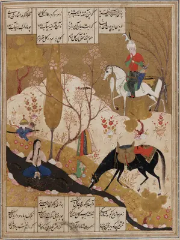

| نام اثر | خسرو و شیرین |
| نویسنده | نظامی |
| نام اصلی اثر | Khosro and Shirin by Nezami  |
| سال چاپ | ۱۱۸۰ |
| کشور | ایران |
| ژانر | شعر کلاسیک |
| تعداد صفحات | حدود ۴۰۰ صفحه |
| امتیاز |  |

### چه چیزی این منظومه را خاص می‌کند
نظامی با «خسرو و شیرین» داستان عاشقانه را در شعر فارسی به اوج رساند و الگویی ساخت که شاعران قرن‌ها از آن تقلید کردند. شیرینِ او معشوقی منفعل نیست؛ زنی است فرمانروا، باوقار و صاحب‌اراده که خسروِ هوس‌باز را وادار می‌کند برای رسیدن به او آدم دیگری شود. در کنار این دو، فرهادِ کوه‌کن ایستاده که عشقِ بی‌چشم‌داشتش به مَثَل بدل شده است. زبان پرتصویر نظامی و مناظره‌های مشهور منظومه، آن را هم داستانی پرکشش و هم یکی از قله‌های شعر غنایی کرده است.

تیتر انگلیسی[1](#f1)

### شخصیت ها
- شخصیت اول: پدر خانواده
- شخصیت دوم: مادر خانواده

### نظر شخصی

<b id="f1">1</b> Khosro and Shirin by Nezami[↩](#a1)

### آنچه از این کتاب در ذهنم ماند
